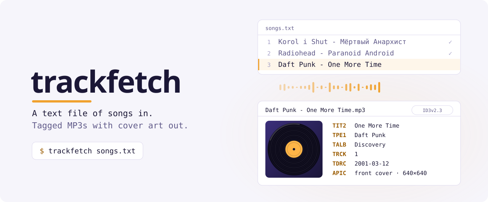

<picture>
  <source media="(prefers-color-scheme: dark)" srcset="https://raw.githubusercontent.com/ByteMe6/trackfetch/master/.github/assets/banner-dark.svg">
  
</picture>

<p align="center">
  <a href="https://github.com/ByteMe6/trackfetch/releases/latest"></a>
  <a href="https://pypi.org/project/trackfetch/"></a>
  <a href="https://github.com/ByteMe6/trackfetch/actions/workflows/release.yml"></a>
  <a href="#install"></a>
  <a href="#standalone-binary"></a>
  <a href="https://github.com/ByteMe6/trackfetch/blob/master/LICENSE"></a>
</p>

<p align="center">
  <b>English</b> · <a href="https://github.com/ByteMe6/trackfetch/blob/master/README.uk.md">Українська</a> · <a href="https://github.com/ByteMe6/trackfetch/blob/master/README.ru.md">Русский</a>
</p>

<p align="center">
  <a href="#install">Install</a> ·
  <a href="#quick-start">Quick start</a> ·
  <a href="#playlists-from-streaming-services">Playlists from streaming services</a> ·
  <a href="#usage">Usage</a> ·
  <a href="#how-it-works">How it works</a> ·
  <a href="#troubleshooting">Troubleshooting</a>
</p>

<br>



<br>

trackfetch reads a plain text file with one `Artist - Title` per line. For every song it looks up metadata and cover art in the configured free sources, picks the best-matching audio on YouTube, and saves an MP3 with complete ID3 tags. Runs are resumable, so you can stop a 1,000-song list at any point and pick it up later.

- **Configurable metadata.** Use iTunes (the default), Deezer, MusicBrainz, VocaDB and optional Spotify. Put them in any priority order with `-s`, or turn them off one by one.
- **Album art.** Artwork comes from the winning metadata source, then the Cover Art Archive for MusicBrainz, then the YouTube thumbnail. The largest available image is embedded in every file.
- **The right upload.** trackfetch scores five YouTube results per song. Official audio wins; covers, karaoke, nightcore, sped-up, slowed, remix and reaction videos lose.
- **Your choice of format.** MP3 for any player, or Opus and M4A that keep YouTube's original audio without re-encoding.
- **Resumable.** Finished songs are logged in `done.txt` and skipped next time. Failures go to `failed.txt` with the reason.
- **Plays everywhere.** Tags are written as ID3v2.3, which Windows Explorer, Apple Music, Android, car stereos and most other players read.
- **Any alphabet.** Cyrillic and other non-Latin titles are matched correctly and kept in filenames. Characters that are illegal in filenames are replaced.
- **No Python needed.** Standalone binaries for Linux, macOS and Windows on x86_64 and ARM64.

## Install

Pick one. Homebrew and Nix also install yt-dlp, FFmpeg and Deno for you; with the other methods, install them yourself ([see below](#dependencies)). The default iTunes source needs no API key. A free Spotify API key is optional and only needed if you select Spotify ([set it up below](#spotify-credentials)).

### Homebrew

macOS and Linux:

```bash
brew install ByteMe6/tap/trackfetch
```

On macOS the formula installs the prebuilt `trackfetch` binary and a static prebuilt `ffmpeg` inside the formula, so `ffmpeg`, the dependency Homebrew used to build for hours on Intel Macs and newer macOS versions, is never compiled. `yt-dlp` and `deno` come from Homebrew as usual.

### Nix

Linux and Apple Silicon Macs, with flakes enabled:

```bash
nix run github:ByteMe6/trackfetch -- songs.txt   # run without installing
nix profile install github:ByteMe6/trackfetch    # install
```

### pipx

```bash
pipx install trackfetch
```

### Standalone binary

No Python required. Download the file for your system from the [latest release](https://github.com/ByteMe6/trackfetch/releases/latest):

| | x86_64 | ARM64 |
| --- | --- | --- |
| **Linux** | [`trackfetch-linux-x86_64`](https://github.com/ByteMe6/trackfetch/releases/latest/download/trackfetch-linux-x86_64) | [`trackfetch-linux-arm64`](https://github.com/ByteMe6/trackfetch/releases/latest/download/trackfetch-linux-arm64) |
| **macOS** | [`trackfetch-macos-x86_64`](https://github.com/ByteMe6/trackfetch/releases/latest/download/trackfetch-macos-x86_64) (Intel) | [`trackfetch-macos-arm64`](https://github.com/ByteMe6/trackfetch/releases/latest/download/trackfetch-macos-arm64) (Apple Silicon) |
| **Windows** | [`trackfetch-windows-x86_64.exe`](https://github.com/ByteMe6/trackfetch/releases/latest/download/trackfetch-windows-x86_64.exe) | [`trackfetch-windows-arm64.exe`](https://github.com/ByteMe6/trackfetch/releases/latest/download/trackfetch-windows-arm64.exe) |

On Linux and macOS, make it executable and put it on your `PATH`:

```bash
chmod +x trackfetch-linux-x86_64
sudo mv trackfetch-linux-x86_64 /usr/local/bin/trackfetch
```

On macOS, if Gatekeeper blocks the unsigned binary, run `xattr -d com.apple.quarantine trackfetch-macos-*` once. Checksums are in `SHA256SUMS.txt` on each release.

### From source

```bash
git clone https://github.com/ByteMe6/trackfetch.git
cd trackfetch
python -m venv .venv && source .venv/bin/activate
pip install -e .
```

### Dependencies

With pipx, a standalone binary or a source install, put these on your `PATH`:

| Tool | Used for | Install |
| --- | --- | --- |
| [yt-dlp](https://github.com/yt-dlp/yt-dlp) | Searching and downloading from YouTube | `pipx install yt-dlp` · `brew install yt-dlp` · `winget install yt-dlp` |
| [FFmpeg](https://ffmpeg.org/) | Converting the audio to MP3 | `sudo apt install ffmpeg` · `brew install ffmpeg` · `winget install ffmpeg` |
| [Deno](https://deno.com/) | JavaScript runtime that yt-dlp needs for YouTube | `curl -fsSL https://deno.land/install.sh \| sh` · `brew install deno` · `winget install DenoLand.Deno` |

## Spotify credentials

trackfetch uses Spotify's Client Credentials flow: no Spotify login, no access to your account.

1. Open the [Spotify Developer Dashboard](https://developer.spotify.com/dashboard) and click **Create app**.
2. Enter any name and description. For the redirect URI, enter `http://127.0.0.1:8888/callback`. trackfetch never uses it, but the form requires one.
3. Open the app's **Settings** and copy the **Client ID** and **Client Secret**.
4. Set them as environment variables:

<details open>
<summary><b>bash / zsh</b></summary>

```bash
export SPOTIFY_CLIENT_ID='your-client-id'
export SPOTIFY_CLIENT_SECRET='your-client-secret'
```

</details>

<details>
<summary><b>fish</b></summary>

```fish
set -Ux SPOTIFY_CLIENT_ID 'your-client-id'
set -Ux SPOTIFY_CLIENT_SECRET 'your-client-secret'
```

</details>

<details>
<summary><b>PowerShell</b></summary>

```powershell
[Environment]::SetEnvironmentVariable('SPOTIFY_CLIENT_ID', 'your-client-id', 'User')
[Environment]::SetEnvironmentVariable('SPOTIFY_CLIENT_SECRET', 'your-client-secret', 'User')
```

</details>

> [!CAUTION]
> Spotipy caches the access token in a `.cache` file in the current directory. Don't commit it or share it.

## Quick start

```bash
cat > songs.txt <<'EOF'
# My playlist
Daft Punk - One More Time
Radiohead - Paranoid Android
Korol i Shut - Мёртвый Анархист
EOF

trackfetch songs.txt
```

The files land in the current directory.

## Playlists from streaming services

You don't have to type the list by hand. [TuneMyMusic](https://www.tunemymusic.com/) exports playlists from Spotify, Apple Music, YouTube Music, Deezer, Tidal, SoundCloud and other services to a text file that trackfetch reads as is:

1. On [tunemymusic.com](https://www.tunemymusic.com/), choose the service your playlist is on as the source.
2. Select the playlists you want.
3. Choose **Export to file** as the destination and save it as **TXT**.
4. Run trackfetch on the exported file:

```bash
trackfetch "My Playlist.txt" -o ~/Music/"My Playlist"
```

## Usage

```text
trackfetch [-h] [--track ARTIST - TITLE ...] [-o OUTPUT] [--config CONFIG] [-f {mp3,m4a,opus}] [--title-only] [--delay DELAY] [-s SOURCES] [--disable-sources SOURCES] [--provider-opt NAME.KEY=VALUE] [--match-threshold SCORE] [--title-threshold SCORE] [--list-sources] [--spotify-client-id ID] [--spotify-client-secret SECRET] [INPUT ...]
```

| Option | Default | What it does |
| --- | --- | --- |
| `INPUT` | optional | Text file with one `Artist - Title` per line, or an inline `Artist - Title` track. Can also be set in the [config file](#configuration-file). |
| `--track` | — | Track to download inline, `Artist - Title`. Can be given several times. |
| `-o`, `--output` | current directory | Folder to save the files in. It's created if it doesn't exist. |
| `--config` | auto-detected | Path to a [config file](#configuration-file). |
| `-f`, `--format` | `m4a` | Audio format: `mp3`, `m4a` or `opus`. See [Audio formats](#audio-formats). |
| `--title-only` | off | Name files `Title.m4a` instead of `Artist - Title.m4a` |
| `--delay` | `1.0` | Seconds to wait between songs. Raise it for long lists. |
| `-s`, `--metadata-sources` | `itunes` | Comma-separated metadata priority, for example `deezer,itunes,musicbrainz`. `none` disables metadata lookups but keeps YouTube. |
| `--disable-sources` | — | Comma-separated sources to disable, for example `spotify,youtube`. |
| `--provider-opt` | — | Provider setting as `NAME.KEY=VALUE`, for example `itunes.country=ua`. Can be repeated. |
| `--match-threshold` | `0.6` | Minimum overall match score, from `0.0` to `1.0`. |
| `--title-threshold` | `0.8` | Minimum title similarity, from `0.0` to `1.0`. |
| `--list-sources` | — | Show available metadata providers and artwork fallbacks, then exit. Makes no network requests. |
| `--spotify-client-id` | `$SPOTIFY_CLIENT_ID` | Spotify API client ID. See [Spotify credentials](#spotify-credentials). |
| `--spotify-client-secret` | `$SPOTIFY_CLIENT_SECRET` | Spotify API client secret. |

```bash
trackfetch songs.txt -o ~/Music/RoadTrip          # save to a specific folder
trackfetch songs.txt -o /media/usb --title-only   # short names for a car stereo
trackfetch big-list.txt --delay 3                 # go easy on rate limits
trackfetch songs.txt --format opus                # original YouTube audio, no re-encode
trackfetch "Daft Punk - One More Time"             # one track, no file needed
trackfetch "A - B" "C - D" --track "E - F"         # a few tracks in one go
trackfetch big-list.txt -s deezer,itunes,musicbrainz
trackfetch big-list.txt --disable-sources youtube  # metadata only, download will fail
trackfetch --list-sources
```

### Metadata sources

The default metadata source is **iTunes**, which needs no API key. YouTube is
always handled separately: it supplies the audio and is the last artwork
fallback. The other providers are off unless you select or enable them:

| Source | Credentials | Minimum interval | Notes |
| --- | --- | --- | --- |
| `itunes` | none | 3.0 s | Storefront country defaults to `us` |
| `deezer` | none | 0.25 s | Public search |
| `musicbrainz` | none | 1.1 s | Cover art comes from the Cover Art Archive |
| `vocadb` | none | 0.5 s | Japanese, Chinese, Korean and Vocaloid metadata |
| `spotify` | client ID and secret | — | Optional, disabled by default |

The order in `-s` is the lookup priority. If the first provider has no suitable
match, trackfetch tries the next one. The first result that passes both
matching thresholds wins.

```bash
trackfetch songs.txt -s deezer,itunes,musicbrainz,vocadb
trackfetch songs.txt -s none                       # no metadata, YouTube audio only
trackfetch songs.txt --provider-opt itunes.country=ua
trackfetch songs.txt --provider-opt musicbrainz.min_interval=1.5
trackfetch songs.txt --match-threshold 0.7 --title-threshold 0.85
```

CJK titles and recognizable Vocaloid hints temporarily promote VocaDB for that
lookup. The configured order is not changed. YouTube remains enabled unless it
is explicitly disabled, even with `-s none`.

Provider failures are handled internally: after two consecutive real failures
(for example a timeout or an HTTP server error) the provider cools down for
30 seconds. The cooldown doubles on each further failure, up to 600 seconds.
A valid empty search, a missing match or missing artwork is not a failure. The
provider is retried after the cooldown and returns to its configured priority
when it recovers.

Metadata is cached per provider in `metadata-cache.json` in the output
directory. A lower-priority cached result never prevents a higher-priority
provider from being retried after recovery.

### Inline tracks

Skip the file and name the tracks right on the command line:

```bash
trackfetch "Daft Punk - One More Time"
trackfetch "Daft Punk - One More Time" "Radiohead - Paranoid Android"
trackfetch --track "Daft Punk - One More Time" --track "Radiohead - Paranoid Android"
```

A file and inline tracks can be mixed: `trackfetch songs.txt --track "Blur - Song 2"`.
The separator is the same ` - ` as in the file, and the first ` - ` splits the
artist from the title.

### Configuration file

Put your defaults in an INI file and forget the flags:

```ini
[trackfetch]
output = ~/Music/trackfetch
format = m4a
title_only = false
delay = 1.0
input = ~/songs.txt

# Metadata source priority
metadata_sources = deezer,itunes,musicbrainz,vocadb

# Sources to exclude
disable_sources = spotify

# Provider settings
spotify_enabled = false
spotify_client_id = your-client-id
spotify_client_secret = your-client-secret

itunes_enabled = true
itunes_country = us
itunes_min_interval = 3.0

deezer_enabled = true
deezer_min_interval = 0.25

musicbrainz_enabled = true
musicbrainz_min_interval = 1.1

vocadb_enabled = true
vocadb_min_interval = 0.5

# YouTube artwork fallback
youtube_enabled = true

# Matching thresholds
match_threshold = 0.6
title_threshold = 0.8
```

Most options above can be set there under the `[trackfetch]` section. Source
priority and the provider settings use the keys shown in the example;
`--track` and `--list-sources` only make sense on the command line. The
precedence is always the same:

1. the command-line flag,
2. the config file,
3. the built-in default (the current directory for the output folder).

trackfetch looks for the config file in this order: the path given with
`--config`, the path in `$TRACKFETCH_CONFIG`, `trackfetch.ini` in the current
directory, `$XDG_CONFIG_HOME/trackfetch/trackfetch.ini`,
`~/.config/trackfetch/trackfetch.ini` and `~/.trackfetch.ini`.

A relative path in the config file, such as `output = songs`, is relative to
the directory you run trackfetch from. A `[DEFAULT]` section works as well.

### Spotify credentials

Spotify is optional and is not queried unless it is selected with
`-s spotify` or `spotify_enabled = true`. Without credentials trackfetch skips
Spotify quietly and uses the other sources. Give the credentials in whichever
way suits you:

```bash
# in the config file
[trackfetch]
spotify_client_id = your-client-id
spotify_client_secret = your-client-secret
```

```bash
# in the environment
export SPOTIFY_CLIENT_ID='your-client-id'
export SPOTIFY_CLIENT_SECRET='your-client-secret'
```

```bash
# on the command line
trackfetch songs.txt --spotify-client-id your-id --spotify-client-secret your-secret
```

The flag wins over the config file, and the config file wins over the
environment variable.

### Audio formats

| Format | What you get | Plays on |
| --- | --- | --- |
| `m4a` (default) | YouTube's **original** AAC audio when available, copied without re-encoding | Apple devices, iTunes, most players |
| `opus` | YouTube's **original** Opus audio, copied without re-encoding. The best quality you can get | most modern players, Android, browsers; not iTunes or older devices |
| `mp3` | YouTube's audio **re-encoded** to the best VBR MP3. A second lossy encode, so slightly below the source | everything, including old players and car stereos |

All three get the same tags and embedded cover art. `done.txt` doesn't track the format, so use a separate `-o` folder for each format.

### Input file

```text
# Lines starting with "#" are comments. Blank lines are ignored.
Daft Punk - One More Time
Sufjan Stevens - Mystery of Love - Remastered   ← only the first " - " separates artist and title
```

The separator is space, hyphen, space (` - `). Lines without it are skipped,
and trackfetch prints how many lines it skipped and which ones they were. See [`examples/songs.txt`](https://github.com/ByteMe6/trackfetch/blob/master/examples/songs.txt).

### Output folder

```text
./
├── Daft Punk - One More Time.m4a
├── Radiohead - Paranoid Android.m4a
├── done.txt      ← finished songs, skipped on the next run
└── failed.txt    ← "Artist - Title | reason" for each song that failed
```

**Retry failures** by stripping the reasons from `failed.txt` and running it again:

```bash
cut -d '|' -f 1 ./failed.txt > retry.txt
trackfetch retry.txt
```

**Re-download a song** by deleting its MP3 and its line in `done.txt`.

### Cheat sheet

A [tldr](https://tldr.sh/) page is in [`docs/tldr/trackfetch.md`](https://github.com/ByteMe6/trackfetch/blob/master/docs/tldr/trackfetch.md). To use it with [tealdeer](https://github.com/tealdeer-rs/tealdeer), copy it into your custom pages folder as `trackfetch.page.md`.

## How it works

1. **Find the metadata.** trackfetch queries the configured providers in priority order. Every result is scored by fuzzy similarity, 70% title and 30% artist. Both the overall `match_threshold` and the `title_threshold` must pass, so an unrelated result is rejected instead of being used. The winning result supplies the title, artists, album details, release date and artwork.
2. **Find the audio on YouTube.** It searches YouTube for the official artist and title and scores the top five results:

   | Signal | Effect on the score |
   | --- | --- |
   | Similarity to the song title | × 0.70 |
   | Similarity to the artist | × 0.30 |
   | `official audio` in the video title | +0.08 |
   | `audio` in the video title | +0.03 |
   | `cover`, `karaoke`, `караоке`, `nightcore`, `sped up`, `slowed`, `remix`, `reaction` | −0.20 each |

3. **Download.** yt-dlp downloads only the winning video and converts it to the chosen format. `m4a` and `opus` keep YouTube's original audio, `mp3` re-encodes it.
4. **Tag.** trackfetch replaces any existing tags with these ID3v2.3 frames:

   | Frame | Content |
   | --- | --- |
   | `TIT2` | Title |
   | `TPE1` | Artists |
   | `TALB` | Album |
   | `TPE2` | Album artist |
   | `TRCK` | Track number |
   | `TDRC` | Release date |
   | `APIC` | Front cover, up to 640×640 |

If no metadata source has a suitable match, the song is still downloaded and tagged with the artist and title from your file. If the metadata result has no artwork, trackfetch tries the Cover Art Archive (for MusicBrainz) and then the YouTube thumbnail, so a missing cover never loses otherwise valid metadata.

## Troubleshooting

<details>
<summary><b>Spotify is selected but no credentials are configured</b></summary>

trackfetch skips Spotify quietly and continues with the remaining sources. To use Spotify, set `SPOTIFY_CLIENT_ID` and `SPOTIFY_CLIENT_SECRET` in the config file or the environment. See [Spotify credentials](#spotify-credentials).

</details>

<details>
<summary><b>A provider is skipped temporarily</b></summary>

After two consecutive network, timeout, server or parsing failures a provider is paused: 30 seconds at first, doubling up to 600 seconds. trackfetch keeps using the other sources and retries the provider when the cooldown expires. Empty search results and missing artwork do not trigger a cooldown.

</details>

<details>
<summary><b>Every song fails with <code>no YouTube result</code> or <code>yt-dlp download failed</code></b></summary>

YouTube changes often. Update yt-dlp first with `pipx upgrade yt-dlp` or `yt-dlp -U`. Recent versions of yt-dlp also need Deno: check that `deno --version` works in the same terminal.

</details>

<details>
<summary><b><code>ERROR: Postprocessing: ffprobe and ffmpeg not found</code></b></summary>

Install FFmpeg and check that `ffmpeg -version` works in the same terminal.

</details>

<details>
<summary><b>The wrong version of a song was downloaded</b></summary>

Make the line in your file more specific, for example by using the exact title as Spotify spells it. Then delete the MP3 and its line in `done.txt` and run trackfetch again. If it keeps picking the wrong upload, [open an issue](https://github.com/ByteMe6/trackfetch/issues/new?template=bug_report.yml) with the `YouTube score` lines from the output.

</details>

<details>
<summary><b>HTTP 429 or other rate-limit errors</b></summary>

Raise `--delay`, for example to `3`. Stopped runs continue where they left off.

</details>

## Development

```bash
pip install -e ".[test]" ruff
ruff check .
pytest --cov=trackfetch
```

The tests stub every network and subprocess call, so they run offline in under a second. To build a standalone binary yourself, run `pip install pyinstaller && pyinstaller trackfetch.spec`; it ends up in `dist/`.

See [CONTRIBUTING.md](https://github.com/ByteMe6/trackfetch/blob/master/CONTRIBUTING.md) before opening a pull request.

### Releasing

Every push to `master` runs the tests on Linux, macOS and Windows. When `version` in [`pyproject.toml`](https://github.com/ByteMe6/trackfetch/blob/master/pyproject.toml) has no matching `vX.Y.Z` tag yet, the [Build & Release](https://github.com/ByteMe6/trackfetch/blob/master/.github/workflows/release.yml) workflow also builds all six binaries and publishes a release, using that version's section of [`CHANGELOG.md`](https://github.com/ByteMe6/trackfetch/blob/master/CHANGELOG.md) as the notes.

To release, move the changes under `[Unreleased]` in the changelog to a new `## [X.Y.Z] - YYYY-MM-DD` section, bump `version`, and push.

> [!IMPORTANT]
> Bump the version in a commit that doesn't edit `.github/workflows/`. GitHub doesn't let the workflow token tag a commit that changes workflow files, so the release step would fail with a 403.

## Disclaimer

trackfetch is for personal use with content you have the right to download. You are responsible for following copyright law where you live and the terms of service of YouTube and Spotify. trackfetch isn't affiliated with or endorsed by Spotify, YouTube or TuneMyMusic. If you can, support the artists you listen to.

## License

trackfetch is free software, released under the [GNU General Public License v3.0 or later](https://github.com/ByteMe6/trackfetch/blob/master/LICENSE). You can use, study, change and share it. If you distribute a modified version, it must stay under the same license.
