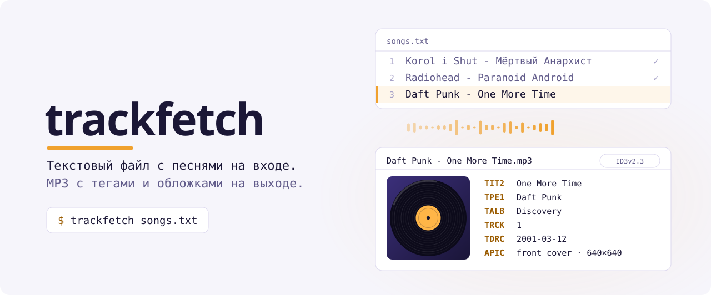
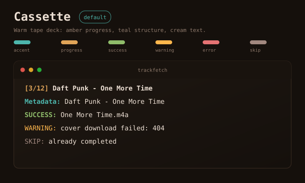
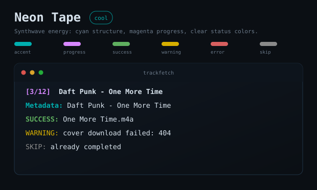
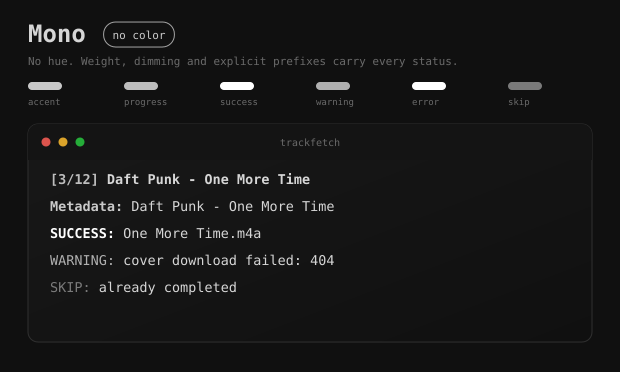
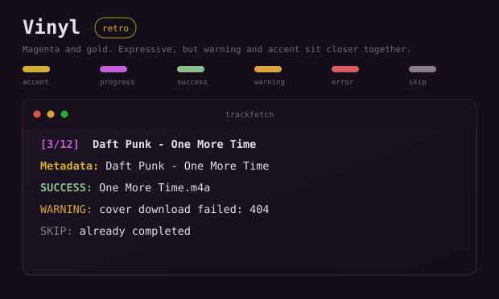

<picture>
  <source media="(prefers-color-scheme: dark)" srcset=".github/assets/banner-dark.ru.svg">
  
</picture>

<p align="center">
  <a href="https://github.com/ByteMe6/trackfetch/releases/latest"></a>
  <a href="https://pypi.org/project/trackfetch/"></a>
  <a href="https://github.com/ByteMe6/trackfetch/actions/workflows/release.yml"></a>
  <a href="#установка"></a>
  <a href="#готовый-бинарник"></a>
  <a href="LICENSE"></a>
</p>

<p align="center">
  <a href="README.md">English</a> · <a href="README.uk.md">Українська</a> · <b>Русский</b>
</p>

<p align="center">
  <a href="#установка">Установка</a> ·
  <a href="#быстрый-старт">Быстрый старт</a> ·
  <a href="#плейлисты-из-стриминговых-сервисов">Плейлисты из стримингов</a> ·
  <a href="#использование">Использование</a> ·
  <a href="#как-это-работает">Как это работает</a> ·
  <a href="#решение-проблем">Решение проблем</a>
</p>

<br>



<br>

trackfetch читает обычный текстовый файл, где на каждой строке записано `Исполнитель - Название`. Для каждой песни он берёт метаданные и обложку из настроенных бесплатных источников, выбирает самое подходящее аудио на YouTube и сохраняет MP3 с полными ID3-тегами. Работу можно прервать в любой момент и продолжить позже, даже если в списке тысяча песен.

- **Настраиваемые метаданные.** iTunes (по умолчанию), Deezer, MusicBrainz, VocaDB и необязательный Spotify. Порядок задаётся через `-s`, а ненужные источники можно отключать.
- **Обложка альбома.** Обложка берётся у победившего источника метаданных, затем из Cover Art Archive для MusicBrainz, затем из превью YouTube. Она уменьшается до 640×640 и перекодируется, если весит больше 100 КиБ.
- **Правильная загрузка.** trackfetch оценивает пять результатов YouTube на каждую песню. Официальное аудио выигрывает, а каверы, караоке, nightcore, ускоренные, замедленные версии, ремиксы и реакции проигрывают.
- **Формат на выбор.** MP3 для любого плеера или Opus и M4A, которые сохраняют оригинальный звук YouTube без перекодирования.
- **Продолжение с места остановки.** Готовые песни записываются в `done.txt` и при следующем запуске пропускаются. Ошибки попадают в `failed.txt` вместе с причиной.
- **Играет везде.** Теги записываются в формате ID3v2.3, который понимают Проводник Windows, Apple Music, Android, автомагнитолы и большинство плееров.
- **Любой алфавит.** Кириллица и другие нелатинские названия правильно сопоставляются и сохраняются в именах файлов. Символы, запрещённые в именах файлов, заменяются.
- **Python не нужен.** Готовые бинарники для Linux, macOS и Windows на x86_64 и ARM64.

## Установка

Выбери любой способ. Homebrew и Nix сами ставят yt-dlp, FFmpeg и Deno; при остальных способах их нужно поставить отдельно ([см. ниже](#зависимости)). Источнику iTunes по умолчанию ключ API не нужен. Бесплатный ключ Spotify API необязателен и нужен только если выбрать Spotify ([как его получить](#ключи-spotify)).

### Homebrew

macOS и Linux:

```bash
brew install ByteMe6/tap/trackfetch
```

На macOS формула ставит готовый бинарник `trackfetch` и статический готовый `ffmpeg` внутри формулы, так что `ffmpeg` — та самая зависимость, которую Homebrew раньше собирал часами на Intel-маках и новых версиях macOS — больше не компилируется. `yt-dlp` и `deno` по-прежнему ставятся из Homebrew.

### Nix

Linux и Mac на Apple Silicon, с включёнными flakes:

```bash
nix run github:ByteMe6/trackfetch -- songs.txt   # запустить без установки
nix profile install github:ByteMe6/trackfetch    # установить
```

### pipx

```bash
pipx install trackfetch
```

### Готовый бинарник

Python не нужен. Скачай файл для своей системы из [последнего релиза](https://github.com/ByteMe6/trackfetch/releases/latest):

| | x86_64 | ARM64 |
| --- | --- | --- |
| **Linux** | [`trackfetch-linux-x86_64`](https://github.com/ByteMe6/trackfetch/releases/latest/download/trackfetch-linux-x86_64) | [`trackfetch-linux-arm64`](https://github.com/ByteMe6/trackfetch/releases/latest/download/trackfetch-linux-arm64) |
| **macOS** | [`trackfetch-macos-x86_64`](https://github.com/ByteMe6/trackfetch/releases/latest/download/trackfetch-macos-x86_64) (Intel) | [`trackfetch-macos-arm64`](https://github.com/ByteMe6/trackfetch/releases/latest/download/trackfetch-macos-arm64) (Apple Silicon) |
| **Windows** | [`trackfetch-windows-x86_64.exe`](https://github.com/ByteMe6/trackfetch/releases/latest/download/trackfetch-windows-x86_64.exe) | [`trackfetch-windows-arm64.exe`](https://github.com/ByteMe6/trackfetch/releases/latest/download/trackfetch-windows-arm64.exe) |

На Linux и macOS сделай файл исполняемым и положи его в `PATH`:

```bash
chmod +x trackfetch-linux-x86_64
sudo mv trackfetch-linux-x86_64 /usr/local/bin/trackfetch
```

Если на macOS Gatekeeper блокирует неподписанный бинарник, один раз выполни `xattr -d com.apple.quarantine trackfetch-macos-*`. Контрольные суммы лежат в `SHA256SUMS.txt` в каждом релизе.

### Из исходников

```bash
git clone https://github.com/ByteMe6/trackfetch.git
cd trackfetch
python -m venv .venv && source .venv/bin/activate
pip install -e .
```

### Зависимости

При установке через pipx, готовым бинарником или из исходников эти программы должны быть в `PATH`:

| Программа | Зачем | Установка |
| --- | --- | --- |
| [yt-dlp](https://github.com/yt-dlp/yt-dlp) | Поиск и загрузка с YouTube | `pipx install yt-dlp` · `brew install yt-dlp` · `winget install yt-dlp` |
| [FFmpeg](https://ffmpeg.org/) | Конвертация звука в MP3 | `sudo apt install ffmpeg` · `brew install ffmpeg` · `winget install ffmpeg` |
| [Deno](https://deno.com/) | Среда JavaScript, без которой yt-dlp не работает с YouTube | `curl -fsSL https://deno.land/install.sh \| sh` · `brew install deno` · `winget install DenoLand.Deno` |

[Pillow](https://python-pillow.org/) (модуль `PIL`) уменьшает обложки. При установке через pip/pipx ставится автоматически, а в готовые бинарники уже встроен, поэтому отдельно в `PATH` его добавлять не нужно.

## Ключи Spotify

trackfetch использует в Spotify режим Client Credentials: входить в аккаунт не нужно, доступа к твоему профилю у программы нет.

1. Открой [Spotify Developer Dashboard](https://developer.spotify.com/dashboard) и нажми **Create app**.
2. Введи любое название и описание. В поле Redirect URI укажи `http://127.0.0.1:8888/callback`. trackfetch его не использует, но без него форма не сохраняется.
3. Открой **Settings** приложения и скопируй **Client ID** и **Client Secret**.
4. Задай их как переменные окружения:

<details open>
<summary><b>bash / zsh</b></summary>

```bash
export SPOTIFY_CLIENT_ID='твой-client-id'
export SPOTIFY_CLIENT_SECRET='твой-client-secret'
```

</details>

<details>
<summary><b>fish</b></summary>

```fish
set -Ux SPOTIFY_CLIENT_ID 'твой-client-id'
set -Ux SPOTIFY_CLIENT_SECRET 'твой-client-secret'
```

</details>

<details>
<summary><b>PowerShell</b></summary>

```powershell
[Environment]::SetEnvironmentVariable('SPOTIFY_CLIENT_ID', 'твой-client-id', 'User')
[Environment]::SetEnvironmentVariable('SPOTIFY_CLIENT_SECRET', 'твой-client-secret', 'User')
```

</details>

> [!CAUTION]
> Spotipy сохраняет токен доступа в файл `.cache` в текущей папке. Не коммить его и никому не передавай.

## Быстрый старт

```bash
cat > songs.txt <<'EOF'
# Мой плейлист
Daft Punk - One More Time
Radiohead - Paranoid Android
Korol i Shut - Мёртвый Анархист
EOF

trackfetch songs.txt
```

Файлы появятся в текущей директории.

## Плейлисты из стриминговых сервисов

Список не обязательно набирать вручную. [TuneMyMusic](https://www.tunemymusic.com/) экспортирует плейлисты из Spotify, Apple Music, YouTube Music, Deezer, Tidal, SoundCloud и других сервисов в текстовый файл, который trackfetch читает без всякой доработки:

1. На [tunemymusic.com](https://www.tunemymusic.com/) выбери в качестве источника сервис, где лежит твой плейлист.
2. Отметь нужные плейлисты.
3. В качестве назначения выбери **Export to file** и сохрани в формате **TXT**.
4. Запусти trackfetch на полученном файле:

```bash
trackfetch "My Playlist.txt" -o ~/Music/"My Playlist"
```

## Использование

```text
trackfetch [-h] [-v] [--track ARTIST - TITLE ...] [-o OUTPUT] [--config CONFIG] [-f {mp3,m4a,opus}] [--title-only] [--delay DELAY] [-s SOURCES] [--disable-sources SOURCES] [--provider-opt NAME.KEY=VALUE] [--match-threshold SCORE] [--title-threshold SCORE] [--list-sources] [--spotify-client-id ID] [--spotify-client-secret SECRET] [--no-logs] [--color {auto,always,never}] [--color-theme THEME] [--themes-file PATH] [--lyrics | --no-lyrics] [--lyrics-type {inline,sidecar,plain}] [INPUT ...]
```

| Параметр | По умолчанию | Что делает |
| --- | --- | --- |
| `INPUT` | необязательный | Текстовый файл, где на каждой строке `Исполнитель - Название`, или трек прямо в аргументе. Можно задать и в [конфиг-файле](#конфиг-файл) |
| `--track` | — | Трек для скачивания прямо из аргументов, `Исполнитель - Название`. Можно указать несколько раз. |
| `-o`, `--output` | текущая директория | Папка для файлов. Если её нет, она будет создана. |
| `-v`, `--version` | — | Показать установленную версию и выйти. |
| `--config` | ищется автоматически | Путь к [конфиг-файлу](#конфиг-файл). |
| `-f`, `--format` | `mp3` | Формат звука: `mp3`, `m4a` или `opus`. См. [Форматы звука](#форматы-звука). |
| `--title-only` | выключен | Называть файлы `Название.m4a` вместо `Исполнитель - Название.m4a` |
| `--delay` | `1.0` | Пауза между песнями в секундах. Для длинных списков её стоит увеличить. |
| `-s`, `--metadata-sources` | `itunes` | Приоритет источников через запятую, например `deezer,itunes,musicbrainz`. `none` отключает метаданные, но оставляет YouTube. Выбор в командной строке переопределяет отключение этих источников в конфиге. |
| `--disable-sources` | — | Источники, которые нужно отключить, например `spotify,youtube`. Имеет приоритет над выбором источника в `-s`. |
| `--provider-opt` | — | Настройка источника `NAME.KEY=VALUE`, например `itunes.country=ua`. Можно повторять. |
| `--match-threshold` | `0.6` | Минимальная общая оценка совпадения от `0.0` до `1.0`. Значения вне диапазона, NaN и бесконечности отклоняются. |
| `--title-threshold` | `0.8` | Минимальное сходство названия от `0.0` до `1.0`. Значения вне диапазона, NaN и бесконечности отклоняются. |
| `--list-sources` | — | Показать доступные источники и запасные варианты обложек и выйти. Сеть не используется. |
| `--spotify-client-id` | `$SPOTIFY_CLIENT_ID` | Client ID для Spotify API. См. [Данные Spotify](#данные-spotify). |
| `--spotify-client-secret` | `$SPOTIFY_CLIENT_SECRET` | Client secret для Spotify API. |
| `--no-logs` | выключен | Не читать `done.txt` и не писать `done.txt` и `failed.txt`. Прогресс прошлых запусков не учитывается, поэтому готовые песни не пропускаются. |
| `--color` | `auto` | Раскрашивать вывод: `auto`, `always` или `never`. `auto` включает цвет в интерактивном терминале и оставляет обычный текст при перенаправлении. `--color always` красит также каналы и логи. |
| `--color-theme` | `cassette` | Встроенная тема (`cassette`, `neon-tape`, `mono`, `vinyl`) или своя тема из `themes.ini`. |
| `--themes-file` | рядом с конфигом | Путь к своему `themes.ini`. По умолчанию файл лежит рядом с `trackfetch.ini`. |
| `--lyrics` / `--no-lyrics` | включён | Встраивать текст из LRCLIB в теги файла. Обычный текст пишется в `USLT` (MP3), `©lyr` (M4A) или `LYRICS` (Opus), синхронизированный — ещё и в тег своего формата. Если текста нет, загрузка не считается ошибкой. |
| `--lyrics-type` | `inline` | Как хранить синхронизированный текст: `inline` кладёт LRC прямо в тег обычного текста (с таймкодами), `sidecar` оставляет тег чистым и пишет отдельный `<файл>.lrc` рядом с аудио, `plain` пишет в теги только обычный текст, а таймкоды оставляет в теге синхронизированного текста. |
| `--cache` / `--no-cache` | включён | Переиспользовать и обновлять `metadata-cache.json` в папке вывода. Отключи, чтобы всегда запрашивать провайдеров заново. |

```bash
trackfetch songs.txt -o ~/Music/RoadTrip          # сохранить в конкретную папку
trackfetch songs.txt -o /media/usb --title-only   # короткие имена для автомагнитолы
trackfetch big-list.txt --delay 3                 # бережнее к лимитам запросов
trackfetch songs.txt --format opus                # оригинальный звук YouTube без перекодирования
trackfetch "Daft Punk - One More Time"             # один трек, файл не нужен
trackfetch "A - B" "C - D" --track "E - F"         # несколько треков за раз
trackfetch big-list.txt -s deezer,itunes,musicbrainz
trackfetch big-list.txt --disable-sources spotify  # явно пропустить Spotify
trackfetch --list-sources
```

### Цветовые темы

Вывод раскрашен по умолчанию темой **Cassette**. Цвет подчёркивает структуру —
метки, статусы, прогресс и разделители, — а названия треков, пути и причины
ошибок остаются обычным текстом. Другую тему можно выбрать флагом или ключом
конфига:

| Настройка | По умолчанию | Что делает |
| --- | --- | --- |
| `--color` / `color` | `auto` | `auto`, `always` или `never`. `auto` красит терминал и оставляет обычный текст в каналах. |
| `--color-theme` / `color_theme` | `cassette` | `cassette`, `neon-tape`, `mono`, `vinyl` или имя своей темы. |
| `--themes-file` / `themes_file` | рядом с конфигом | Свой `themes.ini` с темами и цветами. |

`trackfetch -h` использует ту же тему, что и остальной вывод, включая
заголовки секций, флаги, метавары, варианты выбора и пометки `(default: ...)`.
Тема выбирается до построения текста справки, поэтому
`trackfetch --color always --color-theme vinyl -h` уже цветной, а тема из
конфига применяется и к справке.

<table>
  <tr>
    <td align="center">
      <a href="docs/theme-previews/cassette.svg"></a><br>
      <sub><b>Cassette</b> — по умолчанию</sub>
    </td>
    <td align="center">
      <a href="docs/theme-previews/neon-tape.svg"></a><br>
      <sub><b>Neon Tape</b> — бирюзовый и маджента</sub>
    </td>
  </tr>
  <tr>
    <td align="center">
      <a href="docs/theme-previews/mono.svg"></a><br>
      <sub><b>Mono</b> — без цвета</sub>
    </td>
    <td align="center">
      <a href="docs/theme-previews/vinyl.svg"></a><br>
      <sub><b>Vinyl</b> — маджента и золото</sub>
    </td>
  </tr>
</table>

```bash
trackfetch songs.txt --color never                 # чистые логи и каналы
trackfetch songs.txt --color-theme mono            # другая встроенная тема
trackfetch songs.txt --color-theme sunset          # тема из themes.ini
```

Свои темы, все роли, форматы цветов, расположение файлов и приоритет
настроек описаны в **[Цветовых темах](docs/color-themes.md)**. Своя тема — это
секция INI рядом с конфигом; готовый пример лежит в
[`examples/themes.ini`](examples/themes.ini):

```ini
# ~/.config/trackfetch/themes.ini
[sunset]
base = cassette
accent = #ff8800
progress = 208
success = bright-green
```

```ini
# ~/.config/trackfetch/trackfetch.ini
[trackfetch]
color = auto
color_theme = sunset
```

Для обычного текста задайте `NO_COLOR=1` или `color = never`. Флаг
`--color always` перекрывает и `NO_COLOR`, и `TERM=dumb`.

### Источники метаданных

По умолчанию используется **iTunes**, ключ API не нужен. YouTube обрабатывается
отдельно: он даёт звук и служит последним запасным вариантом обложки. Остальные
источники выключены, пока их не выбрать или не включить:

| Источник | Ключи | Минимальный интервал | Примечания |
| --- | --- | --- | --- |
| `itunes` | не нужны | 3.5 с | Страна магазина по умолчанию `us`. Search API допускает около 20 запросов в минуту, поэтому интервал оставляет небольшой запас |
| `deezer` | не нужны | 0.25 с | Публичный поиск |
| `musicbrainz` | не нужны | 1.1 с | Обложки берутся из Cover Art Archive |
| `vocadb` | не нужны | 0.5 с | Японские, китайские, корейские и Vocaloid-метаданные |
| `spotify` | client ID и secret | — | Необязателен, выключен по умолчанию |

Порядок в `-s` — это приоритет поиска. Если первый источник не дал подходящего
результата, trackfetch пробует следующий. Побеждает первый результат, который
проходит оба порога совпадения. Параметры командной строки переопределяют
конфиг для этого запуска: `-s deezer` включает Deezer, даже если в конфиге он
отключён, а `--disable-sources deezer` по-прежнему его выключает. Оба порога
должны быть конечными числами от `0.0` до `1.0`; недопустимые значения
завершают работу с ошибкой, а не обрезаются молча.

Поиск переживает опечатки, другой регистр, отсутствие дефисов и разницу
`ё`/`е`. Сначала каждый источник пробует точный запрос. Если ничего не
подошло, trackfetch повторяет поиск свободным текстом: `исполнитель название`,
затем `название исполнитель`, затем только название, затем название без
хвостовых слов. Остановка определяется теми же порогами, поэтому ослабленный
запрос не подмешивает постороннюю песню.

После того как все настроенные источники ничего не нашли, trackfetch пробует
два бесплатных запасных источника: `deezer`, затем `musicbrainz`. Запасные
источники пропускаются, если их отключили через `--disable-sources` или конфиг,
а также когда метаданные выключены полностью (`-s none`).

```bash
trackfetch songs.txt -s deezer,itunes,musicbrainz,vocadb
trackfetch songs.txt -s none                       # без метаданных, только звук YouTube
trackfetch songs.txt --provider-opt itunes.country=ua
trackfetch songs.txt --provider-opt musicbrainz.min_interval=1.5
trackfetch songs.txt --match-threshold 0.7 --title-threshold 0.85
```

Для CJK-названий и явных подсказок Vocaloid VocaDB временно поднимается в
приоритете только для этого поиска. Настроенный порядок не меняется. YouTube
остаётся включённым, пока его явно не отключить, даже при `-s none`. Отключение
YouTube также отключает загрузку звука, потому что YouTube — единственный
источник аудио.

Сбои источников обрабатываются внутри: после двух настоящих ошибок подряд
(таймаут, ошибка сервера и т. п.) источник уходит в паузу на 30 секунд. Каждая
следующая ошибка удваивает паузу до 600 секунд. Пустой поиск, отсутствие
подходящего результата или обложки ошибкой не считаются. После паузы источник
пробуется снова и возвращается на своё место в приоритете.

Метаданные кешируются отдельно для каждого источника в `metadata-cache.json` в
папке вывода. В записях кеша хранится и длительность трека — она используется
дальше при подборе видео на YouTube и текста. Результат из кеша источника с
низким приоритетом не мешает повторной попытке источника с высоким
приоритетом после восстановления.

Формат обложки определяется по самим байтам, а не по URL или заголовку HTTP
`Content-Type`. JPEG, PNG, GIF и WebP сохраняют правильное расширение и MIME
тип. MP3 и Opus могут встраивать все четыре формата; M4A поддерживает JPEG и
PNG, поэтому GIF или WebP для этого контейнера пропускается, а не помечается
как JPEG.
```

### Текст песни

Для всех форматов trackfetch также ищет текст на [LRCLIB](https://lrclib.net/)
и встраивает его в теги. Каждый формат использует свой стандартный тег.

| Формат | Обычный текст | Синхронизированный текст |
| --- | --- | --- |
| `mp3` | ID3 `USLT` | ID3 `SYLT`, только если источник вернул синхронизированный текст |
| `m4a` | атом `©lyr` | freeform-атом `SYNCEDLYRICS` (`com.apple.iTunes`), исходный LRC |
| `opus` | Vorbis-комментарий `LYRICS` | Vorbis-комментарий `SYNCEDLYRICS`, исходный LRC |

Если синхронизированный текст есть, `--lyrics-type` решает, где он окажется:

- `inline` (по умолчанию) дополнительно кладёт LRC в тег обычного текста.
  Плееры, которые разбирают LRC из этого тега, показывают синхронизацию, а
  остальные видят таймкоды `[00:01.00]` как обычный текст.
- `sidecar` оставляет тег чистым и пишет `<файл>.lrc` рядом с аудио. Плееры,
  которые читают LRC-файл рядом с треком, показывают синхронизацию, остальные
  видят обычный текст. Файл `.lrc` нужно переносить вместе с аудио.
- `plain` пишет в теги только обычный текст, а таймкоды оставляет в теге
  синхронизированного текста.

Если есть только обычный текст, записывается только он. Искусственные
таймкоды не создаются.

Источник — LRCLIB, ключ API не нужен. По умолчанию встраивание включено для
всех трёх форматов; отключить можно флагом `--no-lyrics` или строкой
`lyrics_enabled = false` в конфиге. Режим задаётся строкой
`lyrics_type = inline|sidecar|plain`.

LRCLIB сначала ищется по названию трека без исполнителя, затем более свободными
запросами (та же релаксация, что и для метаданных). Результаты ранжируются
локально по названию, исполнителю и длительности: версия, отличающаяся от
реальной длительности на несколько секунд, выигрывает. При равенстве
предпочитается вариант с синхронизированным текстом. Обычно печатается одна из
строк:

- `Lyrics: synced (embedded)` или `Lyrics: synced (sidecar + tags)`
- `Lyrics: plain only (no synced version)`
- `Lyrics: not found`

Если текст не найден, произошла ошибка сети или сервер вернул ошибку, загрузка
не прерывается: файл сохраняется с обычными метаданными. Если в файле уже была
лирика, а новая не найдена, старые теги остаются. При новой лирике прежние
теги текста заменяются, а не дублируются. Остальные теги, обложка и сами
аудиоданные не перекодируются и не повреждаются.

```bash
trackfetch songs.txt                              # встроить текст (по умолчанию, любой формат)
trackfetch songs.txt --format mp3 --no-lyrics     # не добавлять текст в теги
```

### Треки прямо в аргументах

Можно не заводить файл, а назвать треки прямо в командной строке:

```bash
trackfetch "Daft Punk - One More Time"
trackfetch "Daft Punk - One More Time" "Radiohead - Paranoid Android"
trackfetch --track "Daft Punk - One More Time" --track "Radiohead - Paranoid Android"
```

Файл и треки из аргументов можно смешивать: `trackfetch songs.txt --track "Blur - Song 2"`.
Разделитель тот же, что и в файле, ` - `, и первое ` - ` отделяет исполнителя
от названия. Строки без разделителя пропускаются, и trackfetch печатает, сколько
их пропустил и какие именно.

### Конфиг-файл

Все дефолты можно вынести в INI-файл и забыть про флаги:

```ini
[trackfetch]
output = ~/Music/trackfetch
format = m4a
title_only = false
delay = 1.0
input = ~/songs.txt

# Приоритет источников метаданных
metadata_sources = deezer,itunes,musicbrainz,vocadb

# Приоритет музыкальных источников
music_sources = youtube,soundcloud

# Исключённые источники
disable_sources = spotify

# Настройки источников
spotify_enabled = false
spotify_client_id = твой-client-id
spotify_client_secret = твой-client-secret
no_logs = false

# Цвета терминала
color = auto
color_theme = cassette
# themes_file = ~/.config/trackfetch/themes.ini

itunes_enabled = true
itunes_country = us
itunes_min_interval = 3.5

deezer_enabled = true
deezer_min_interval = 0.25

musicbrainz_enabled = true
musicbrainz_min_interval = 1.1

vocadb_enabled = true
vocadb_min_interval = 0.5

# Музыкальные источники
youtube_enabled = true
soundcloud_enabled = true
soundcloud_trigger = age
soundcloud_ambiguous = skip

# Встраивание текста песни в теги файла
lyrics_enabled = true
lyrics_type = inline

# Кеш метаданных (metadata-cache.json в папке вывода)
cache_enabled = true

# Пороги совпадения
match_threshold = 0.6
title_threshold = 0.8
```

Большинство параметров из таблицы выше можно задать там, в секции
`[trackfetch]`. Приоритет источников и настройки провайдеров используют ключи
из примера; `--track` и `--list-sources` уместны только в командной строке.
Приоритет всегда одинаковый:

1. флаг в командной строке,
2. конфиг-файл,
3. встроенное значение по умолчанию (для папки вывода — текущая директория).

Для источников список `-s` в командной строке переопределяет и
`metadata_sources`, и конфликтующие `disable_sources`/`*_enabled=false` для
названных в нём источников. Явное отключение через `--disable-sources` или
`--provider-opt NAME.enabled=false` имеет приоритет над выбором в `-s`. Сам
конфиг-файл никогда не изменяется.

Конфиг-файл ищется в таком порядке: путь из `--config`, путь из
`$TRACKFETCH_CONFIG`, `trackfetch.ini` в текущей директории,
`$XDG_CONFIG_HOME/trackfetch/trackfetch.ini`,
`~/.config/trackfetch/trackfetch.ini` и `~/.trackfetch.ini`.

Относительный путь в конфиг-файле, например `output = songs`, считается от
текущей директории. Секция `[DEFAULT]` тоже работает.

### Данные Spotify

Spotify необязателен и не используется, пока его не выбрать через
`-s spotify` или `spotify_enabled = true`. Без ключей trackfetch молча
пропускает Spotify и берёт данные из других источников. Ключи можно задать
любым удобным способом:

```bash
# в конфиг-файле
[trackfetch]
spotify_client_id = твой-client-id
spotify_client_secret = твой-client-secret
```

```bash
# в переменных окружения
export SPOTIFY_CLIENT_ID='твой-client-id'
export SPOTIFY_CLIENT_SECRET='твой-client-secret'
```

```bash
# флагами в командной строке
trackfetch songs.txt --spotify-client-id твой-id --spotify-client-secret твой-secret
```

Флаг важнее конфиг-файла, а конфиг-файл важнее переменной окружения.

### Форматы звука

| Формат | Что получаешь | Где играет |
| --- | --- | --- |
| `mp3` (по умолчанию) | Звук YouTube, **перекодированный** в MP3 VBR максимального качества. Это повторное сжатие с потерями, поэтому чуть хуже исходника | везде, включая старые плееры и автомагнитолы |
| `m4a` | **Оригинальный** звук YouTube в AAC, если он есть, скопированный без перекодирования | устройства Apple, iTunes, большинство плееров |
| `opus` | **Оригинальный** звук YouTube в Opus, скопированный без перекодирования. Лучшее доступное качество | большинство современных плееров, Android, браузеры; не iTunes и не старые устройства |

Во всех трёх форматах одинаковые метаданные, встроенная обложка и текст песни. `done.txt` не учитывает формат, поэтому для каждого формата указывай отдельную папку `-o`.

### Входной файл

```text
# Строки, начинающиеся с "#", — комментарии. Пустые строки пропускаются.
Daft Punk - One More Time
Sufjan Stevens - Mystery of Love - Remastered   ← исполнителя и название разделяет только первый " - "
```

Разделитель: пробел, дефис, пробел (` - `). Строки без разделителя пропускаются. Пример: [`examples/songs.txt`](examples/songs.txt).

### Папка с результатами

```text
./
├── Daft Punk - One More Time.m4a
├── Radiohead - Paranoid Android.m4a
├── done.txt      ← готовые песни, при следующем запуске пропускаются
└── failed.txt    ← "Исполнитель - Название | причина" для каждой неудачной песни
```

**Повторить неудачные:** убери причины из `failed.txt` и запусти ещё раз:

```bash
cut -d '|' -f 1 ./failed.txt > retry.txt
trackfetch retry.txt
```

**Скачать песню заново:** удали её MP3 и её строку в `done.txt`.

При `--no-logs` trackfetch не читает `done.txt` и не пишет `done.txt` или
`failed.txt`. Поэтому прогресс между запусками не восстанавливается: песни,
готовые в прошлом запуске, скачиваются снова, а файл с ошибками не создаётся
и не обновляется. `failed.txt` — журнал только для записи в любом режиме.

### Шпаргалка

Страница для [tldr](https://tldr.sh/) лежит в [`docs/tldr/trackfetch.md`](docs/tldr/trackfetch.md). Чтобы пользоваться ей в [tealdeer](https://github.com/tealdeer-rs/tealdeer), скопируй её в папку пользовательских страниц под именем `trackfetch.page.md`.

## Как это работает

1. **Поиск метаданных.** trackfetch опрашивает настроенные источники по приоритету. Каждый результат оценивается по нечёткому сходству: 70% даёт название, 30% исполнитель. Нужно пройти и общий `match_threshold`, и `title_threshold`, поэтому неподходящий результат отклоняется. Если все запросы ничего не нашли, поиск повторяется с более слабой формулировкой, а после настроенных источников пробуются запасные `deezer` и `musicbrainz`. Победитель даёт название, исполнителей, альбом, дату выхода, длительность и обложку.
2. **Поиск аудио на YouTube.** trackfetch ищет на YouTube официальные исполнителя и название и оценивает первые пять результатов:

   | Признак | Влияние на оценку |
   | --- | --- |
   | Сходство с названием песни | × 0.70 |
   | Сходство с исполнителем | × 0.30 |
   | `official audio` в названии ролика | +0.08 |
   | `audio` в названии ролика | +0.03 |
   | Длительность в пределах 3 секунд от метаданных | +0.05 |
   | Длительность в пределах 10 секунд | +0.02 |
   | `cover`, `karaoke`, `караоке`, `nightcore`, `sped up`, `slowed`, `remix`, `reaction` | −0.20 за каждое |

   Если запрос с исполнителем ничего не находит, trackfetch повторяет поиск по `<название>`, а затем по `<название> Topic`; результатам без исполнителя нужно подтверждение исполнителя, поэтому каверы и песни других артистов с тем же названием отклоняются. Если все три запроса не дали подходящего результата, включается запасной поиск YouTube Music, который не фильтруется для некоторых тем так, как анонимный поиск YouTube. Каждый кандидат из YouTube Music проверяется по полным данным ролика: название должно быть близким, исполнитель (или канал) должен совпадать, а известные длительности могут отличаться не более чем на 10 секунд.

3. **Загрузка.** yt-dlp скачивает только победивший ролик и конвертирует его в выбранный формат. `m4a` и `opus` сохраняют оригинальный звук YouTube, `mp3` перекодирует.
4. **Теги.** trackfetch заменяет все существующие теги этими фреймами ID3v2.3:

   | Фрейм | Содержимое |
   | --- | --- |
   | `TIT2` | Название |
   | `TPE1` | Исполнители |
   | `TALB` | Альбом |
   | `TPE2` | Исполнитель альбома |
   | `TRCK` | Номер трека |
   | `TDRC` | Дата выхода |
   | `APIC` | Обложка, до 640×640 |

Если ни один источник не дал подходящего результата, песня всё равно скачивается и получает теги с исполнителем и названием из твоего файла. Если у результата нет обложки, trackfetch пробует Cover Art Archive (для MusicBrainz), а затем превью YouTube, поэтому отсутствие обложки не теряет остальные метаданные.

## Решение проблем

<details>
<summary><b>Spotify выбран, но ключи не заданы</b></summary>

trackfetch молча пропускает Spotify и продолжает с остальными источниками. Чтобы использовать Spotify, задай `SPOTIFY_CLIENT_ID` и `SPOTIFY_CLIENT_SECRET` в конфиг-файле или переменных окружения. См. [Ключи Spotify](#ключи-spotify).

</details>

<details>
<summary><b>Источник временно пропускается</b></summary>

После двух настоящих ошибок подряд (сеть, таймаут, сервер или разбор ответа) источник ставится на паузу: сначала 30 секунд, затем всё дольше, до 600 секунд. trackfetch продолжает использовать другие источники и повторяет попытку после паузы. Пустые результаты и отсутствие обложки паузу не вызывают.

</details>

<details>
<summary><b>Все песни падают с <code>no YouTube result</code> или <code>yt-dlp download failed</code></b></summary>

YouTube часто меняется. Сначала обнови yt-dlp: `pipx upgrade yt-dlp` или `yt-dlp -U`. Новым версиям yt-dlp также нужен Deno: проверь, что `deno --version` работает в том же терминале.

</details>

<details>
<summary><b><code>ERROR: Postprocessing: ffprobe and ffmpeg not found</code></b></summary>

Установи FFmpeg и проверь, что `ffmpeg -version` работает в том же терминале.

</details>

<details>
<summary><b>Скачалась не та версия песни</b></summary>

Уточни строку в файле, например напиши название точно так, как оно записано в Spotify. Затем удали MP3 и его строку в `done.txt` и запусти trackfetch снова. Если программа продолжает выбирать не тот ролик, [создай issue](https://github.com/ByteMe6/trackfetch/issues/new?template=bug_report.yml) и приложи строки `YouTube score` из вывода.

</details>

<details>
<summary><b>HTTP 429 и другие ошибки лимита запросов</b></summary>

Увеличь `--delay`, например до `3`. Прерванный запуск продолжится с того места, где остановился.

</details>

## Разработка

```bash
pip install -e ".[test]" ruff
ruff check .
pytest --cov=trackfetch
```

Тесты подменяют все сетевые запросы и внешние процессы, поэтому работают без интернета меньше чем за секунду. Чтобы собрать бинарник самому, выполни `pip install pyinstaller && pyinstaller trackfetch.spec`; результат появится в `dist/`.

Перед pull request прочитай [CONTRIBUTING.md](CONTRIBUTING.md) (на английском).

### Релизы

Каждый push в `master` запускает тесты на Linux, macOS и Windows. Если для `version` из [`pyproject.toml`](pyproject.toml) ещё нет тега `vX.Y.Z`, workflow [Build & Release](.github/workflows/release.yml) дополнительно собирает все шесть бинарников и публикует релиз. Описанием релиза становится раздел этой версии из [`CHANGELOG.md`](CHANGELOG.md).

Чтобы выпустить релиз, перенеси изменения из `[Unreleased]` в новый раздел `## [X.Y.Z] - ГГГГ-ММ-ДД`, подними `version` и сделай push.

> [!IMPORTANT]
> Поднимай версию в коммите, который не меняет `.github/workflows/`. GitHub не разрешает токену workflow ставить тег на коммит с изменёнными workflow-файлами, и публикация релиза упадёт с ошибкой 403.

## Отказ от ответственности

trackfetch предназначен для личного использования и только для контента, который ты вправе скачивать. Ты сам отвечаешь за соблюдение авторского права в своей стране и условий использования YouTube и Spotify. trackfetch не связан со Spotify, YouTube и TuneMyMusic и не одобрен ими. Если есть возможность, поддерживай артистов, которых слушаешь.

## Контрибьюторы

<a href="https://github.com/ByteMe6/trackfetch/graphs/contributors">
  
</a>

## Лицензия

trackfetch — свободное программное обеспечение под лицензией [GNU General Public License v3.0 или более поздней версии](LICENSE). Его можно использовать, изучать, изменять и распространять. Изменённые версии при распространении должны оставаться под той же лицензией.
