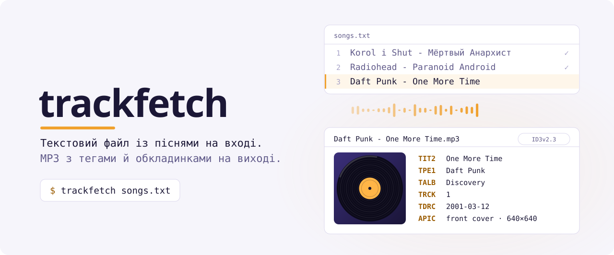

<picture>
  <source media="(prefers-color-scheme: dark)" srcset=".github/assets/banner-dark.uk.svg">
  
</picture>

<p align="center">
  <a href="https://github.com/ByteMe6/trackfetch/releases/latest"></a>
  <a href="https://pypi.org/project/trackfetch/"></a>
  <a href="https://github.com/ByteMe6/trackfetch/actions/workflows/release.yml"></a>
  <a href="#встановлення"></a>
  <a href="#готовий-бінарний-файл"></a>
  <a href="LICENSE"></a>
</p>

<p align="center">
  <a href="README.md">English</a> · <b>Українська</b> · <a href="README.ru.md">Русский</a>
</p>

<p align="center">
  <a href="#встановлення">Встановлення</a> ·
  <a href="#швидкий-старт">Швидкий старт</a> ·
  <a href="#плейлисти-зі-стрімінгових-сервісів">Плейлисти зі стрімінгів</a> ·
  <a href="#використання">Використання</a> ·
  <a href="#як-це-працює">Як це працює</a> ·
  <a href="#усунення-несправностей">Усунення несправностей</a>
</p>

<br>



<br>

trackfetch читає звичайний текстовий файл, де в кожному рядку записано `Виконавець - Назва`. Для кожної пісні він бере метадані й обкладинку з налаштованих безкоштовних джерел, обирає найвідповідніше аудіо на YouTube і зберігає MP3 з повними ID3-тегами. Роботу можна перервати будь-коли й продовжити пізніше, навіть якщо у списку тисяча пісень.

- **Налаштовувані метадані.** iTunes (за замовчуванням), Deezer, MusicBrainz, VocaDB і необов'язковий Spotify. Порядок задається через `-s`, а непотрібні джерела можна вимикати.
- **Обкладинка альбому.** Обкладинка береться з джерела-переможця, потім із Cover Art Archive для MusicBrainz, потім із прев'ю YouTube. У файл вбудовується найбільший доступний варіант.
- **Правильне завантаження.** trackfetch оцінює п'ять результатів YouTube для кожної пісні. Офіційне аудіо виграє, а кавери, караоке, nightcore, прискорені, сповільнені версії, ремікси й реакції програють.
- **Формат на вибір.** MP3 для будь-якого плеєра або Opus і M4A, які зберігають оригінальний звук YouTube без перекодування.
- **Продовження з місця зупинки.** Готові пісні записуються в `done.txt` і під час наступного запуску пропускаються. Помилки потрапляють у `failed.txt` разом із причиною.
- **Грає всюди.** Теги записуються у форматі ID3v2.3, який розуміють Провідник Windows, Apple Music, Android, автомагнітоли й більшість плеєрів.
- **Будь-яка абетка.** Кирилиця та інші нелатинські назви правильно зіставляються й зберігаються в іменах файлів. Символи, заборонені в іменах файлів, замінюються.
- **Python не потрібен.** Готові бінарні файли для Linux, macOS і Windows на x86_64 та ARM64.

## Встановлення

Обери будь-який спосіб. Homebrew і Nix самі встановлюють yt-dlp, FFmpeg і Deno; для інших способів їх треба встановити окремо ([див. нижче](#залежності)). Джерелу iTunes за замовчуванням ключ API не потрібен. Безкоштовний ключ Spotify API необов'язковий і потрібен лише якщо вибрати Spotify ([як його отримати](#ключі-spotify)).

### Homebrew

macOS і Linux:

```bash
brew install ByteMe6/tap/trackfetch
```

На macOS формула ставить готовий бінарник `trackfetch` і статичний готовий `ffmpeg` усередині формули, тож `ffmpeg` — та сама залежність, яку Homebrew раніше збирав годинами на Intel-маках і нових версіях macOS — більше не компілюється. `yt-dlp` і `deno`, як і раніше, ставляться з Homebrew.

### Nix

Linux і Mac на Apple Silicon, з увімкненими flakes:

```bash
nix run github:ByteMe6/trackfetch -- songs.txt   # запустити без встановлення
nix profile install github:ByteMe6/trackfetch    # встановити
```

### pipx

```bash
pipx install trackfetch
```

### Готовий бінарний файл

Python не потрібен. Завантаж файл для своєї системи з [останнього релізу](https://github.com/ByteMe6/trackfetch/releases/latest):

| | x86_64 | ARM64 |
| --- | --- | --- |
| **Linux** | [`trackfetch-linux-x86_64`](https://github.com/ByteMe6/trackfetch/releases/latest/download/trackfetch-linux-x86_64) | [`trackfetch-linux-arm64`](https://github.com/ByteMe6/trackfetch/releases/latest/download/trackfetch-linux-arm64) |
| **macOS** | [`trackfetch-macos-x86_64`](https://github.com/ByteMe6/trackfetch/releases/latest/download/trackfetch-macos-x86_64) (Intel) | [`trackfetch-macos-arm64`](https://github.com/ByteMe6/trackfetch/releases/latest/download/trackfetch-macos-arm64) (Apple Silicon) |
| **Windows** | [`trackfetch-windows-x86_64.exe`](https://github.com/ByteMe6/trackfetch/releases/latest/download/trackfetch-windows-x86_64.exe) | [`trackfetch-windows-arm64.exe`](https://github.com/ByteMe6/trackfetch/releases/latest/download/trackfetch-windows-arm64.exe) |

На Linux і macOS зроби файл виконуваним і поклади його в `PATH`:

```bash
chmod +x trackfetch-linux-x86_64
sudo mv trackfetch-linux-x86_64 /usr/local/bin/trackfetch
```

Якщо на macOS Gatekeeper блокує непідписаний файл, один раз виконай `xattr -d com.apple.quarantine trackfetch-macos-*`. Контрольні суми є у `SHA256SUMS.txt` у кожному релізі.

### З вихідного коду

```bash
git clone https://github.com/ByteMe6/trackfetch.git
cd trackfetch
python -m venv .venv && source .venv/bin/activate
pip install -e .
```

### Залежності

Під час встановлення через pipx, готовим бінарним файлом або з вихідного коду ці програми мають бути в `PATH`:

| Програма | Навіщо | Встановлення |
| --- | --- | --- |
| [yt-dlp](https://github.com/yt-dlp/yt-dlp) | Пошук і завантаження з YouTube | `pipx install yt-dlp` · `brew install yt-dlp` · `winget install yt-dlp` |
| [FFmpeg](https://ffmpeg.org/) | Конвертація звуку в MP3 | `sudo apt install ffmpeg` · `brew install ffmpeg` · `winget install ffmpeg` |
| [Deno](https://deno.com/) | Середовище JavaScript, без якого yt-dlp не працює з YouTube | `curl -fsSL https://deno.land/install.sh \| sh` · `brew install deno` · `winget install DenoLand.Deno` |

## Ключі Spotify

trackfetch використовує у Spotify режим Client Credentials: входити в акаунт не потрібно, доступу до твого профілю програма не має.

1. Відкрий [Spotify Developer Dashboard](https://developer.spotify.com/dashboard) і натисни **Create app**.
2. Введи будь-яку назву й опис. У полі Redirect URI вкажи `http://127.0.0.1:8888/callback`. trackfetch його не використовує, але без нього форма не зберігається.
3. Відкрий **Settings** застосунку й скопіюй **Client ID** та **Client Secret**.
4. Задай їх як змінні середовища:

<details open>
<summary><b>bash / zsh</b></summary>

```bash
export SPOTIFY_CLIENT_ID='твій-client-id'
export SPOTIFY_CLIENT_SECRET='твій-client-secret'
```

</details>

<details>
<summary><b>fish</b></summary>

```fish
set -Ux SPOTIFY_CLIENT_ID 'твій-client-id'
set -Ux SPOTIFY_CLIENT_SECRET 'твій-client-secret'
```

</details>

<details>
<summary><b>PowerShell</b></summary>

```powershell
[Environment]::SetEnvironmentVariable('SPOTIFY_CLIENT_ID', 'твій-client-id', 'User')
[Environment]::SetEnvironmentVariable('SPOTIFY_CLIENT_SECRET', 'твій-client-secret', 'User')
```

</details>

> [!CAUTION]
> Spotipy зберігає токен доступу у файл `.cache` у поточній теці. Не коміть його й нікому не передавай.

## Швидкий старт

```bash
cat > songs.txt <<'EOF'
# Мій плейлист
Daft Punk - One More Time
Radiohead - Paranoid Android
Korol i Shut - Мёртвый Анархист
EOF

trackfetch songs.txt
```

Файли з'являться в поточній директорії.

## Плейлисти зі стрімінгових сервісів

Список не обов'язково набирати вручну. [TuneMyMusic](https://www.tunemymusic.com/) експортує плейлисти зі Spotify, Apple Music, YouTube Music, Deezer, Tidal, SoundCloud та інших сервісів у текстовий файл, який trackfetch читає без жодних змін:

1. На [tunemymusic.com](https://www.tunemymusic.com/) обери джерелом сервіс, де лежить твій плейлист.
2. Познач потрібні плейлисти.
3. Як призначення обери **Export to file** і збережи у форматі **TXT**.
4. Запусти trackfetch на отриманому файлі:

```bash
trackfetch "My Playlist.txt" -o ~/Music/"My Playlist"
```

## Використання

```text
trackfetch [-h] [--track ARTIST - TITLE ...] [-o OUTPUT] [--config CONFIG] [-f {mp3,m4a,opus}] [--title-only] [--delay DELAY] [-s SOURCES] [--disable-sources SOURCES] [--provider-opt NAME.KEY=VALUE] [--match-threshold SCORE] [--title-threshold SCORE] [--list-sources] [--spotify-client-id ID] [--spotify-client-secret SECRET] [INPUT ...]
```

| Параметр | За замовчуванням | Що робить |
| --- | --- | --- |
| `INPUT` | необов'язковий | Текстовий файл, де в кожному рядку `Виконавець - Назва`, або трек просто в аргументі. Можна задати й у [конфіг-файлі](#конфіг-файл) |
| `--track` | — | Трек для завантаження просто з аргументів, `Виконавець - Назва`. Можна вказати кілька разів. |
| `-o`, `--output` | поточна директорія | Тека для файлів. Якщо її немає, вона буде створена. |
| `--config` | шукається автоматично | Шлях до [конфіг-файлу](#конфіг-файл). |
| `-f`, `--format` | `m4a` | Формат звуку: `mp3`, `m4a` або `opus`. Див. [Формати звуку](#формати-звуку). |
| `--title-only` | вимкнено | Називати файли `Назва.m4a` замість `Виконавець - Назва.m4a` |
| `--delay` | `1.0` | Пауза між піснями в секундах. Для довгих списків її варто збільшити. |
| `-s`, `--metadata-sources` | `itunes` | Пріоритет джерел через кому, наприклад `deezer,itunes,musicbrainz`. `none` вимикає метадані, але залишає YouTube. |
| `--disable-sources` | — | Джерела, які треба вимкнути, наприклад `spotify,youtube`. |
| `--provider-opt` | — | Налаштування джерела `NAME.KEY=VALUE`, наприклад `itunes.country=ua`. Можна повторювати. |
| `--match-threshold` | `0.6` | Мінімальна загальна оцінка збігу від `0.0` до `1.0`. |
| `--title-threshold` | `0.8` | Мінімальна схожість назви від `0.0` до `1.0`. |
| `--list-sources` | — | Показати доступні джерела й запасні варіанти обкладинок і вийти. Мережа не використовується. |
| `--spotify-client-id` | `$SPOTIFY_CLIENT_ID` | Client ID для Spotify API. Див. [Дані Spotify](#дані-spotify). |
| `--spotify-client-secret` | `$SPOTIFY_CLIENT_SECRET` | Client secret для Spotify API. |

```bash
trackfetch songs.txt -o ~/Music/RoadTrip          # зберегти в конкретну теку
trackfetch songs.txt -o /media/usb --title-only   # короткі імена для автомагнітоли
trackfetch big-list.txt --delay 3                 # дбайливіше до лімітів запитів
trackfetch songs.txt --format opus                # оригінальний звук YouTube без перекодування
trackfetch "Daft Punk - One More Time"             # один трек, файл не потрібен
trackfetch "A - B" "C - D" --track "E - F"         # кілька треків за раз
trackfetch big-list.txt -s deezer,itunes,musicbrainz
trackfetch big-list.txt --disable-sources spotify  # явно пропустити Spotify
trackfetch --list-sources
```

### Джерела метаданих

За замовчуванням використовується **iTunes**, ключ API не потрібен. YouTube
обробляється окремо: він дає звук і служить останнім запасним варіантом
обкладинки. Інші джерела вимкнені, доки їх не вибрати або не ввімкнути:

| Джерело | Ключі | Мінімальний інтервал | Примітки |
| --- | --- | --- | --- |
| `itunes` | не потрібні | 3.0 с | Країна магазину за замовчуванням `us` |
| `deezer` | не потрібні | 0.25 с | Публічний пошук |
| `musicbrainz` | не потрібні | 1.1 с | Обкладинки з Cover Art Archive |
| `vocadb` | не потрібні | 0.5 с | Японські, китайські, корейські та Vocaloid-метадані |
| `spotify` | client ID і secret | — | Необов'язковий, вимкнений за замовчуванням |

Порядок у `-s` — це пріоритет пошуку. Якщо перше джерело не дало відповідного
результату, trackfetch пробує наступне. Перемагає перший результат, який
проходить обидва пороги збігу.

```bash
trackfetch songs.txt -s deezer,itunes,musicbrainz,vocadb
trackfetch songs.txt -s none                       # без метаданих, лише звук YouTube
trackfetch songs.txt --provider-opt itunes.country=ua
trackfetch songs.txt --provider-opt musicbrainz.min_interval=1.5
trackfetch songs.txt --match-threshold 0.7 --title-threshold 0.85
```

Для CJK-назв і явних підказок Vocaloid VocaDB тимчасово піднімається в
пріоритеті лише для цього пошуку. Налаштований порядок не змінюється. YouTube
залишається ввімкненим, доки його явно не вимкнути, навіть при `-s none`.
Вимкнення YouTube також вимикає завантаження звуку, бо YouTube — єдине
джерело аудіо.

Збої джерел обробляються всередині: після двох справжніх помилок поспіль
(таймаут, помилка сервера тощо) джерело йде на паузу на 30 секунд. Кожна
наступна помилка подвоює паузу до 600 секунд. Порожній пошук, відсутність
відповідного результату або обкладинки помилкою не вважаються. Після паузи
джерело пробується знову й повертається на своє місце в пріоритеті.

Метадані кешуються окремо для кожного джерела в `metadata-cache.json` у теці
виводу. Результат із кешу джерела з низьким пріоритетом не заважає повторній
спробі джерела з високим пріоритетом після відновлення.
```

### Треки просто в аргументах

Можна не заводити файл, а назвати треки просто в командному рядку:

```bash
trackfetch "Daft Punk - One More Time"
trackfetch "Daft Punk - One More Time" "Radiohead - Paranoid Android"
trackfetch --track "Daft Punk - One More Time" --track "Radiohead - Paranoid Android"
```

Файл і треки з аргументів можна змішувати: `trackfetch songs.txt --track "Blur - Song 2"`.
Роздільник той самий, що й у файлі, ` - `, і перше ` - ` відділяє виконавця
від назви. Рядки без роздільника пропускаються, і trackfetch друкує, скільки
їх пропущено та які саме.

### Конфіг-файл

Усі дефолти можна винести в INI-файл і забути про прапорці:

```ini
[trackfetch]
output = ~/Music/trackfetch
format = m4a
title_only = false
delay = 1.0
input = ~/songs.txt

# Пріоритет джерел метаданих
metadata_sources = deezer,itunes,musicbrainz,vocadb

# Виключені джерела
disable_sources = spotify

# Налаштування джерел
spotify_enabled = false
spotify_client_id = твій-client-id
spotify_client_secret = твій-client-secret

itunes_enabled = true
itunes_country = us
itunes_min_interval = 3.0

deezer_enabled = true
deezer_min_interval = 0.25

musicbrainz_enabled = true
musicbrainz_min_interval = 1.1

vocadb_enabled = true
vocadb_min_interval = 0.5

# Запасна обкладинка YouTube
youtube_enabled = true

# Пороги збігу
match_threshold = 0.6
title_threshold = 0.8
```

Більшість параметрів із таблиці вище можна задати там, у секції
`[trackfetch]`. Пріоритет джерел і налаштування провайдерів використовують
ключі з прикладу; `--track` і `--list-sources` мають сенс лише в командному
рядку. Пріоритет завжди однаковий:

1. прапорець у командному рядку,
2. конфіг-файл,
3. вбудоване значення за замовчуванням (для теки виводу — поточна директорія).

Конфіг-файл шукається в такому порядку: шлях із `--config`, шлях із
`$TRACKFETCH_CONFIG`, `trackfetch.ini` у поточній директорії,
`$XDG_CONFIG_HOME/trackfetch/trackfetch.ini`,
`~/.config/trackfetch/trackfetch.ini` і `~/.trackfetch.ini`.

Відносний шлях у конфіг-файлі, наприклад `output = songs`, рахується від
поточної директорії. Секція `[DEFAULT]` теж працює.

### Дані Spotify

Spotify необов'язковий і не використовується, доки його не вибрати через
`-s spotify` або `spotify_enabled = true`. Без ключів trackfetch мовчки
пропускає Spotify і бере дані з інших джерел. Ключі можна задати будь-яким
зручним способом:

```bash
# у конфіг-файлі
[trackfetch]
spotify_client_id = твій-client-id
spotify_client_secret = твій-client-secret
```

```bash
# у змінних оточення
export SPOTIFY_CLIENT_ID='твій-client-id'
export SPOTIFY_CLIENT_SECRET='твій-client-secret'
```

```bash
# прапорцями в командному рядку
trackfetch songs.txt --spotify-client-id твій-id --spotify-client-secret твій-secret
```

Прапорець важливіший за конфіг-файл, а конфіг-файл важливіший за змінну оточення.

### Формати звуку

| Формат | Що отримуєш | Де грає |
| --- | --- | --- |
| `m4a` (за замовчуванням) | **Оригінальний** звук YouTube в AAC, якщо він є, скопійований без перекодування | пристрої Apple, iTunes, більшість плеєрів |
| `opus` | **Оригінальний** звук YouTube в Opus, скопійований без перекодування. Найкраща доступна якість | більшість сучасних плеєрів, Android, браузери; не iTunes і не старі пристрої |
| `mp3` (за замовчуванням) | Звук YouTube, **перекодований** у MP3 VBR максимальної якості. Це повторне стиснення з втратами, тому трохи гірше за оригінал | усюди, зокрема старі плеєри й автомагнітоли |

У всіх трьох форматах однакові теги й вбудована обкладинка. `done.txt` не враховує формат, тому для кожного формату вказуй окрему теку `-o`.

### Вхідний файл

```text
# Рядки, що починаються з "#", — коментарі. Порожні рядки пропускаються.
Daft Punk - One More Time
Sufjan Stevens - Mystery of Love - Remastered   ← виконавця й назву розділяє лише перший " - "
```

Роздільник: пробіл, дефіс, пробіл (` - `). Рядки без роздільника пропускаються. Приклад: [`examples/songs.txt`](examples/songs.txt).

### Тека з результатами

```text
./
├── Daft Punk - One More Time.m4a
├── Radiohead - Paranoid Android.m4a
├── done.txt      ← готові пісні, під час наступного запуску пропускаються
└── failed.txt    ← "Виконавець - Назва | причина" для кожної невдалої пісні
```

**Повторити невдалі:** прибери причини з `failed.txt` і запусти ще раз:

```bash
cut -d '|' -f 1 ./failed.txt > retry.txt
trackfetch retry.txt
```

**Завантажити пісню заново:** видали її MP3 і її рядок у `done.txt`.

### Шпаргалка

Сторінка для [tldr](https://tldr.sh/) лежить у [`docs/tldr/trackfetch.md`](docs/tldr/trackfetch.md). Щоб користуватися нею в [tealdeer](https://github.com/tealdeer-rs/tealdeer), скопіюй її в теку користувацьких сторінок під іменем `trackfetch.page.md`.

## Як це працює

1. **Пошук метаданих.** trackfetch опитує налаштовані джерела за пріоритетом. Кожен результат оцінюється за нечіткою схожістю: 70% дає назва, 30% виконавець. Потрібно пройти і загальний `match_threshold`, і `title_threshold`, тому невідповідний результат відхиляється. Переможець дає назву, виконавців, альбом, дату виходу й обкладинку.
2. **Пошук аудіо на YouTube.** trackfetch шукає на YouTube офіційних виконавця й назву та оцінює перші п'ять результатів:

   | Ознака | Вплив на оцінку |
   | --- | --- |
   | Схожість із назвою пісні | × 0.70 |
   | Схожість із виконавцем | × 0.30 |
   | `official audio` у назві ролика | +0.08 |
   | `audio` у назві ролика | +0.03 |
   | `cover`, `karaoke`, `караоке`, `nightcore`, `sped up`, `slowed`, `remix`, `reaction` | −0.20 за кожне |

3. **Завантаження.** yt-dlp завантажує лише ролик-переможець і конвертує його в обраний формат. `m4a` і `opus` зберігають оригінальний звук YouTube, `mp3` перекодовує.
4. **Теги.** trackfetch замінює всі наявні теги такими фреймами ID3v2.3:

   | Фрейм | Вміст |
   | --- | --- |
   | `TIT2` | Назва |
   | `TPE1` | Виконавці |
   | `TALB` | Альбом |
   | `TPE2` | Виконавець альбому |
   | `TRCK` | Номер треку |
   | `TDRC` | Дата виходу |
   | `APIC` | Обкладинка, до 640×640 |

Якщо жодне джерело не дало відповідного результату, пісня все одно завантажується й отримує теги з виконавцем і назвою з твого файлу. Якщо в результату немає обкладинки, trackfetch пробує Cover Art Archive (для MusicBrainz), а потім прев'ю YouTube, тож відсутність обкладинки не втрачає інші метадані.

## Усунення несправностей

<details>
<summary><b>Spotify вибрано, але ключі не задано</b></summary>

trackfetch мовчки пропускає Spotify і продовжує з іншими джерелами. Щоб використовувати Spotify, задай `SPOTIFY_CLIENT_ID` і `SPOTIFY_CLIENT_SECRET` у конфіг-файлі або змінних оточення. Див. [Ключі Spotify](#ключі-spotify).

</details>

<details>
<summary><b>Джерело тимчасово пропускається</b></summary>

Після двох справжніх помилок поспіль (мережа, таймаут, сервер або розбір відповіді) джерело ставиться на паузу: спочатку 30 секунд, далі дедалі довше, до 600 секунд. trackfetch продовжує використовувати інші джерела й повторює спробу після паузи. Порожні результати та відсутність обкладинки паузу не викликають.

</details>

<details>
<summary><b>Усі пісні падають з <code>no YouTube result</code> або <code>yt-dlp download failed</code></b></summary>

YouTube часто змінюється. Спершу онови yt-dlp: `pipx upgrade yt-dlp` або `yt-dlp -U`. Новим версіям yt-dlp також потрібен Deno: перевір, що `deno --version` працює в тому самому терміналі.

</details>

<details>
<summary><b><code>ERROR: Postprocessing: ffprobe and ffmpeg not found</code></b></summary>

Встанови FFmpeg і перевір, що `ffmpeg -version` працює в тому самому терміналі.

</details>

<details>
<summary><b>Завантажилася не та версія пісні</b></summary>

Уточни рядок у файлі, наприклад напиши назву точно так, як її записано у Spotify. Потім видали MP3 і його рядок у `done.txt` та запусти trackfetch знову. Якщо програма й далі обирає не той ролик, [створи issue](https://github.com/ByteMe6/trackfetch/issues/new?template=bug_report.yml) і додай рядки `YouTube score` з виводу.

</details>

<details>
<summary><b>HTTP 429 та інші помилки ліміту запитів</b></summary>

Збільш `--delay`, наприклад до `3`. Перерваний запуск продовжиться з того місця, де зупинився.

</details>

## Розробка

```bash
pip install -e ".[test]" ruff
ruff check .
pytest --cov=trackfetch
```

Тести підміняють усі мережеві запити й зовнішні процеси, тому працюють без інтернету менш ніж за секунду. Щоб зібрати бінарний файл самостійно, виконай `pip install pyinstaller && pyinstaller trackfetch.spec`; результат з'явиться в `dist/`.

Перед pull request прочитай [CONTRIBUTING.md](CONTRIBUTING.md) (англійською).

### Релізи

Кожен push у `master` запускає тести на Linux, macOS і Windows. Якщо для `version` з [`pyproject.toml`](pyproject.toml) ще немає тегу `vX.Y.Z`, workflow [Build & Release](.github/workflows/release.yml) додатково збирає всі шість бінарних файлів і публікує реліз. Описом релізу стає розділ цієї версії з [`CHANGELOG.md`](CHANGELOG.md).

Щоб випустити реліз, перенеси зміни з `[Unreleased]` у новий розділ `## [X.Y.Z] - РРРР-ММ-ДД`, підніми `version` і зроби push.

> [!IMPORTANT]
> Піднімай версію в коміті, який не змінює `.github/workflows/`. GitHub не дозволяє токену workflow ставити тег на коміт зі зміненими workflow-файлами, і публікація релізу впаде з помилкою 403.

## Відмова від відповідальності

trackfetch призначений для особистого використання й лише для контенту, який ти маєш право завантажувати. Ти сам відповідаєш за дотримання авторського права у своїй країні та умов використання YouTube і Spotify. trackfetch не пов'язаний зі Spotify, YouTube і TuneMyMusic і не схвалений ними. Якщо маєш змогу, підтримуй артистів, яких слухаєш.

## Ліцензія

trackfetch — вільне програмне забезпечення під ліцензією [GNU General Public License v3.0 або новішої версії](LICENSE). Його можна використовувати, вивчати, змінювати й поширювати. Змінені версії під час поширення мають залишатися під тією самою ліцензією.
