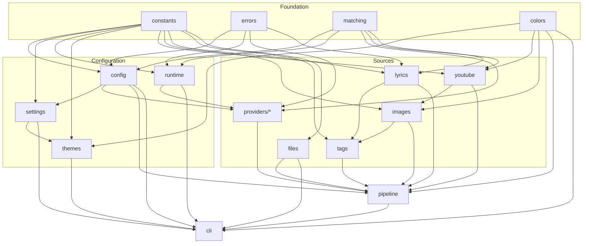

# Architecture

TrackFetch used to be one `trackfetch.py` module. It is now a small package
with one responsibility per module. The public API is still available from
`import trackfetch`, so the console script and existing integrations keep
working.

## Module map

```
trackfetch/
├── __init__.py          Public facade and re-exports
├── __main__.py          python -m trackfetch
├── constants.py         Defaults, provider tables, regexes
├── errors.py            ProviderError / ProviderAuthError
├── colors.py            Built-in color themes and ANSI rendering
├── themes.py            Custom themes.ini discovery and parsing
├── matching.py          Normalization, similarity and candidate scoring
├── config.py            SourceConfig, thresholds and provider priority
├── settings.py          Config-file discovery and CLI/config precedence
├── runtime.py           Health tracking, rate limiter, cache, HTTP session
├── providers/
│   ├── spotify.py       Optional Spotify provider
│   ├── itunes.py        iTunes Search API
│   ├── deezer.py        Deezer Search API
│   ├── musicbrainz.py   MusicBrainz + Cover Art Archive
│   ├── vocadb.py        VocaDB
│   ├── registry.py      name -> provider function
│   └── resolver.py      Priority, cooldowns, cache-aware resolution
├── youtube.py           Search, scoring and yt-dlp audio download
├── images.py            Cover detection, download, Pillow normalization and fallback chain
├── lyrics.py            LRCLIB lookup and LRC parsing
├── tags.py              MP3 / Opus / M4A tag writers
├── files.py             Filenames, song parsing, done/failed logs
├── pipeline.py          One-song orchestration
└── cli.py               Argument parsing and run loop
```

## Dependency direction

Dependencies point in one direction:



This keeps the network providers independent from the CLI and makes each
piece testable on its own. `providers/registry.py` is the only place that
knows which providers exist; adding a provider means adding one module and
one registry entry.

## Design rules

- **One run, one `MetadataRuntime`.** It owns the HTTP session, rate
  limiter, provider health, cache and Spotify client. Providers receive it
  instead of creating module-level clients.
- **Providers return candidates; the resolver decides.** Provider functions
  only translate an API response into the common metadata dict. Thresholds,
  priority, cooldowns and caching live in `providers/resolver.py`.
- **The pipeline is the only place that knows the full download order.**
  Resolve metadata → pick a filename → search YouTube → download audio →
  download cover → embed tags and lyrics → move the finished file.
- **The CLI never implements domain logic.** It parses arguments, builds a
  `SourceConfig`, creates the runtime and loops over songs.
- **Public names stay re-exported from `trackfetch/__init__.py`.** Tests and
  external code can keep using `trackfetch.normalize(...)`, while new code
  can import from the focused module directly.

## Adding a metadata provider

1. Create `trackfetch/providers/<name>.py` with a function that accepts
   `(runtime, artist, title, config)` and returns a list of candidate dicts.
2. Register it in `trackfetch/providers/registry.py`.
3. Add the provider to `METADATA_PROVIDERS`, `PROVIDER_DEFAULTS` and
   `PROVIDER_OPTIONS` in `trackfetch/constants.py`.
4. Re-export the provider function from `trackfetch/__init__.py` if it
   should be part of the public API.
