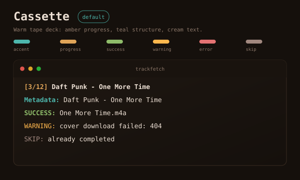
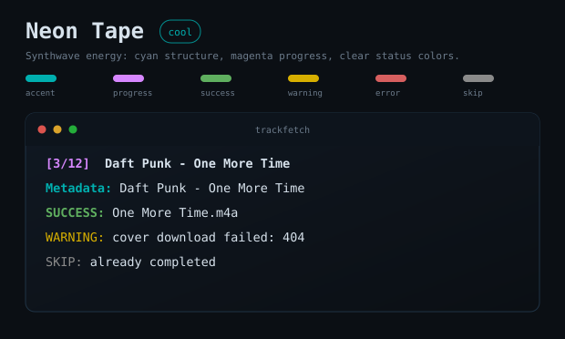
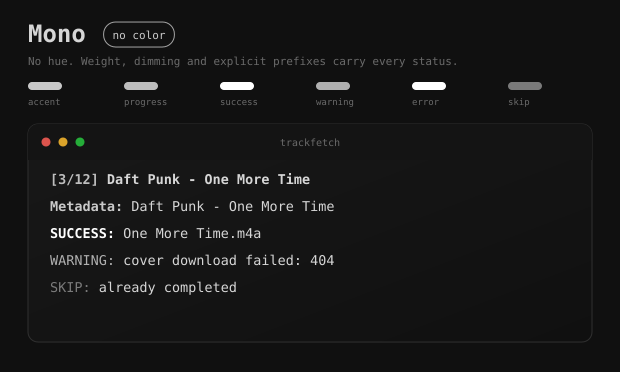
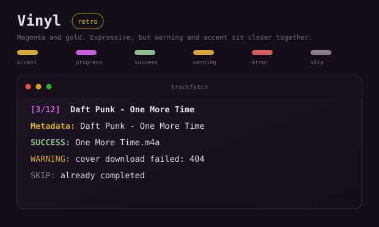

# Color themes

TrackFetch colorizes run output by default. The default theme is
**Cassette**: teal structure, amber progress, semantic green/amber/red
statuses and cream text on dark terminals.

Color is used for structure, not data. Status prefixes, labels, counters and
separators are colored; artist names, titles, file names, paths, scores and
error reasons stay in the terminal's normal text color. Every status keeps
its `SUCCESS`, `SKIP`, `WARNING` or `FAILED` word, so nothing depends on
color alone.

## Gallery

Click a preview to open the full-size SVG.

<table>
  <tr>
    <td align="center">
      <a href="theme-previews/cassette.svg"></a><br>
      <sub><b>Cassette</b> — default</sub>
    </td>
    <td align="center">
      <a href="theme-previews/neon-tape.svg"></a><br>
      <sub><b>Neon Tape</b> — cyan and magenta</sub>
    </td>
  </tr>
  <tr>
    <td align="center">
      <a href="theme-previews/mono.svg"></a><br>
      <sub><b>Mono</b> — no hue</sub>
    </td>
    <td align="center">
      <a href="theme-previews/vinyl.svg"></a><br>
      <sub><b>Vinyl</b> — magenta and gold</sub>
    </td>
  </tr>
</table>

## Quick start

```bash
trackfetch songs.txt                          # Cassette, color on a terminal
trackfetch songs.txt --color never            # plain output
trackfetch songs.txt --color always           # force color, even in a pipe
trackfetch songs.txt --color-theme mono       # choose another built-in theme
trackfetch songs.txt --color-theme vinyl --color always
```

## Settings

| CLI flag | Config key | Default | Values |
| --- | --- | --- | --- |
| `--color` | `color` | `auto` | `auto`, `always`, `never` |
| `--color-theme` | `color_theme` | `cassette` | a built-in theme or a name from `themes.ini` |
| `--themes-file` | `themes_file` | `themes.ini` next to the config | path to a custom theme file |

`--color auto` means color on an interactive terminal and plain text when
output is redirected. `--color always` keeps color in pipes and log files.
`--color never` always writes plain text.

`themes_file` may be absolute or relative; a relative path is resolved from
the current directory. `--themes-file` wins over the config key.

In `auto` mode TrackFetch also respects the usual environment switches:

| Environment | Effect |
| --- | --- |
| `NO_COLOR` (non-empty) | disables color |
| `TERM=dumb` | disables color |
| `COLORTERM=truecolor` or `24bit` | emits 24-bit colors |
| `TERM` containing `256color` | emits 256-color codes |

`--color always` overrides `NO_COLOR` and `TERM=dumb`.

## Where themes live

The custom theme file is `themes.ini` in the same directory as the active
`trackfetch.ini`:

| Config file | Theme file |
| --- | --- |
| `~/.config/trackfetch/trackfetch.ini` | `~/.config/trackfetch/themes.ini` |
| `./trackfetch.ini` | `./themes.ini` |
| `$TRACKFETCH_CONFIG=/etc/trackfetch.ini` | `/etc/themes.ini` |

If no config file exists, TrackFetch looks for `themes.ini` in the same
directories where it looks for `trackfetch.ini`:

1. the directory of `$TRACKFETCH_CONFIG`, if set;
2. the current directory;
3. `$XDG_CONFIG_HOME/trackfetch`;
4. `~/.config/trackfetch`;
5. the home directory.

A missing auto-discovered `themes.ini` is fine. A missing file passed with
`--themes-file` or set as `themes_file` is an error. A ready-to-copy example
with two custom themes lives in
[`examples/themes.ini`](../examples/themes.ini).

## Custom themes

Add one or more sections to `themes.ini`. Each section is a theme. Theme
names and keys are case-insensitive. Built-in names (`cassette`,
`neon-tape`, `mono`, `vinyl`) are reserved.

```ini
[sunset]
base = cassette
accent = #ff8800
accent_bright = #ffb366
progress = 208
success = bright-green
warning = #ffcc00
error = #ff5555
skip = 244
muted = 240
frame = 238
text = #f2e9de
```

Select it in `trackfetch.ini`:

```ini
[trackfetch]
color = auto
color_theme = sunset
```

Or without editing the config:

```bash
trackfetch songs.txt --color-theme sunset
trackfetch songs.txt --themes-file ~/my-themes.ini --color-theme sunset
```

`base` is optional and defaults to `cassette`. A custom theme may inherit
from any built-in theme or from a custom theme defined earlier in the same
file. Every role not listed keeps its inherited color, so a two-line theme
is valid.

### Roles

| Role | What it colors | Notes |
| --- | --- | --- |
| `text` | the current track line | `default` means the terminal's normal color |
| `accent` | `Metadata:`, `Selected:`, `Config:`, `Output:` labels and provider names | main structural color |
| `accent_bright` | `FINISHED` and section headings | strongest heading color |
| `progress` | `[3/12]` song counter | bold is added automatically |
| `success` | `SUCCESS`, `enabled`, embedded lyrics, downloaded cover source | bold is added automatically |
| `warning` | `WARNING` lines and `No songs to download.` | |
| `error` | `ERROR`, `FAILED` and a non-zero failed total | bold is added automatically |
| `skip` | `SKIP` lines and a non-zero skipped total | already completed items |
| `muted` | scores, paths, disabled values, zero totals, secondary details | dimmed context |
| `frame` | the `====` separators | |

Only the foreground color is changed. Backgrounds, blinking and reverse
video are never used, so the theme works on both dark and light terminals.

### Color formats

Every role accepts:

| Format | Example | Result |
| --- | --- | --- |
| Hex | `#ff8800` or `#f80` | exact color on truecolor terminals |
| xterm 256 index | `208` | palette entry 0-255 |
| Name | `bright-green` | standard ANSI color |
| Default | `default`, `none`, `terminal` or empty | no color, terminal default |

Named colors: `black`, `red`, `green`, `yellow`, `blue`, `magenta`, `cyan`,
`white`, `bright-black`, `bright-red`, `bright-green`, `bright-yellow`,
`bright-blue`, `bright-magenta`, `bright-cyan`, `bright-white`, plus `gray`
and `grey` (aliases for `bright-black`).

Hex and 256-color values are converted to the nearest supported color on
simpler terminals: 16-color terminals get one of the standard ANSI colors,
256-color terminals get a palette index, and truecolor terminals get the
exact RGB value.

### Precedence

1. command-line flag;
2. `trackfetch.ini`;
3. built-in default (`auto`, `cassette`, sibling `themes.ini`).

The config file is never rewritten. Invalid keys, unknown bases, reserved
theme names and malformed colors stop the run with a clear error that names
the theme and option.

## What the colors mean

| Output | Style |
| --- | --- |
| `====` separators | `frame` |
| `[3/12]` | `progress` + bold |
| current track | `text` + bold |
| `Metadata:`, `Selected:`, `Config:`, `Output:` | `accent` + bold |
| `Searching YouTube:`, scores, paths | `muted` |
| `SUCCESS:` | `success` + bold |
| `SKIP:` | `skip` |
| `WARNING:` | `warning` |
| `ERROR:`, `FAILED:` | `error` + bold |
| `FINISHED` | `accent_bright` + bold |
| enabled / disabled in `--list-sources` | `success` / `muted` |

Redirected output, `--color never`, `NO_COLOR` and `TERM=dumb` produce the
same plain text as earlier TrackFetch versions, with no escape sequences.

## Troubleshooting

- **No color in a terminal:** check `--color`, `NO_COLOR`, `TERM=dumb` and
  whether the output is piped through another program.
- **Custom theme is ignored:** the theme name must match a section in
  `themes.ini`; built-in names cannot be redefined. Use `--themes-file` if
  the file is not next to your config.
- **Colors look wrong over SSH:** the remote `TERM` may advertise fewer
  colors. Hex values are converted automatically, but a theme tuned for
  truecolor can look different in 16-color mode.
- **Need clean logs:** set `color = never` or pass `--color never`.
